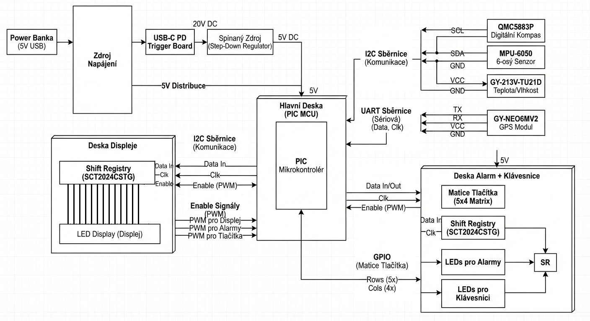

# DE2-DSKY

**8. Apollo DSKY console maquette**: maketa ovládacího rozhraní DSKY z kosmické lodi Apollo.

## O DSKY

**DSKY** (Display and Keyboard) bylo uživatelské rozhraní palubního počítače **Apollo Guidance Computer (AGC)**, vyvinutého v MIT Instrumentation Laboratory. Prostřednictvím DSKY komunikovali astronauti s počítačem během letů na Měsíc.

### Co DSKY umožňovalo

- zadávat příkazy a data do počítače,
- kontrolovat stav lodi,
- počítat korekce dráhy,
- řídit motory,
- provádět astronomickou navigaci.

### Systém VERB a NOUN

Místo textového nebo grafického rozhraní se používal jednoduchý dvojslovný systém:

- **VERB** (sloveso) určuje, *jakou akci* provést,
- **NOUN** (podstatné jméno) určuje, *čeho se akce týká*.

Příklad: `VERB 16 NOUN 36` znamená "průběžně zobrazuj čas počítače".

### Displej a kontrolky

Údaje se zobrazovaly na elektroluminiscenčním displeji, který ukazoval číselné hodnoty ve třech řádcích (registry R1, R2, R3) a kódy programu, VERB a NOUN. Součástí panelu byla také sada stavových kontrolek, například:

- `COMP ACTY` (počítač právě pracuje),
- `PROG` (chyba programu),
- `OPR ERR` (chyba obsluhy),
- `GIMBAL LOCK` (blokace kardanového závěsu).

## O projektu

Cílem projektu je co nejvěrněji napodobit rozhraní **DSKY** z Apolla. Maketa je postavená na **Raspberry Pi Pico** a **vlastní desce plošných spojů (PCB)**.

### Funkce

- Zadávání příkazů systémem **VERB / NOUN** stejně jako v Apolu.
- Několik původních kombinací VERB a NOUN, například zobrazení času.
- Čtení dat z **GPS** a **IMU** přes vlastní VERB/NOUN kódy.
- Vlastní příkazy nad rámec originálu.

### Autentičnost

- **Klávesnice:** mechanické spínače pro odpovídající hmat a zvuk tlačítek.
- **Displej:** místo hotových displejů jsou segmenty tvořeny jednotlivými LED diodami, nad kterými je tvarovaný difuzér. Ten světlo rozptýlí a vytvoří tvar sedmisegmentové číslice. Barva a vzhled se tak co nejvíc blíží původnímu elektroluminiscenčnímu displeji.
- **Kontrolky:** stavové indikátory (původně žárovičky v oknech kontrolek) jsou na panelu ve stejném uspořádání jako na originále.

### Multiplexování

Aby se ušetřily piny Pica, je většina periferií řízena **multiplexně**:

- **Klávesnice** je zapojena jako maticová (řádky a sloupce).
- **LED segmenty displeje** jsou ovládány multiplexem, kdy se jednotlivé číslice rychle střídají.
- **Kontrolky** jsou ve vlastní multiplexní matici.

## Schéma

### Blokové schéma obvodu




## Hardware

### Kusovník (BOM)

| Součástka | Funkce v obvodu | Počet | Odkaz / Datasheet |
| :--- | :--- | :--- | :--- |
| **Raspberry Pi Pico (RP2040)** | Hlavní řídicí mikrokontrolér (skenování matice 5×4, řízení shift registrů, 3× PWM pro jas LED, I2C a UART komunikace) | 1 ks | [Raspberry Pi Pico Datasheet (PDF)](https://datasheets.raspberrypi.com/pico/pico-datasheet.pdf) |
| **SCT2024CSTG** | 16kanálový LED driver (posuvný registr s konstantním proudem a pinem `OE` pro PWM stmívání samostatných větví) | X ks *(min. 3 ks)* | [SCT2024 Datasheet (AllDatasheet)](https://www.alldatasheet.com/view.jsp?Searchword=SCT2024) |
| **Keychron K Pro Switch Mint** | Mechanické spínače pro uživatelskou klávesnici zapojenou v matici 5×4 | 20 ks *(1 balení = 110 ks)* | [Alza – Keychron K Pro Switch Mint](https://www.alza.cz/keychron-k-pro-switch-mint-110-pcs-d12749940.htm) |
| **LED diody (displej, alarmy, tlačítka)** | Optická indikace, segmenty displeje a podsvícení kláves | *k doplnění* | *Doplnit dle konkrétních typů* |
| **Step-down modul s LM2596** | Spínaný snižující DC-DC měnič z 20 V (z PD triggeru) na 5 V pro napájení elektroniky a LED | 2–3 ks *(dle odběru)* | [Drátek – Modul LM2596](https://dratek.cz/arduino-platforma/1303-stepdown-nastavitelny-menic-s-lm2596-dc-dc.html) / [TI LM2596 Datasheet (PDF)](https://www.ti.com/lit/ds/symlink/lm2596.pdf) |
| **USB-C PD Trigger Board (20 V)** | Vyjednání 20V napájecího profilu z powerbanky přes USB-C Power Delivery | 1 ks | [HUSB238 / PD Trigger reference](https://www.alldatasheet.com/view.jsp?Searchword=HUSB238) |
| **QMC5883P (modul)** | 3osý magnetometr (digitální kompas), připojený na sběrnici I2C | 1 ks | [QMC5883P Datasheet (AllDatasheet)](https://www.alldatasheet.com/view.jsp?Searchword=QMC5883P) |
| **MPU-6050 (modul)** | 6osý inerciální senzor (3osý akcelerometr + 3osý gyroskop) na sběrnici I2C | 1 ks | [MPU-6050 Datasheet (TDK InvenSense)](https://invensense.tdk.com/wp-content/uploads/2015/02/MPU-6000-Datasheet1.pdf) |
| **GY-213V-TU21D (čip HTU21D)** | Senzor teploty a relativní vlhkosti na sběrnici I2C | 1 ks | [HTU21D Datasheet (AllDatasheet)](https://www.alldatasheet.com/view.jsp?Searchword=HTU21D) |
| **GY-NEO6MV2 (čip u-blox NEO-6M)** | GPS přijímač komunikující přes TTL sériovou linku (UART) | 1 ks | [u-blox NEO-6 Datasheet (AllDatasheet)](https://www.alldatasheet.com/view.jsp?Searchword=NEO-6M) |

## Software

- Jazyk / platforma: MicroPython
- Knihovny: [doplnit]

## Fotky / ukázka

-

## Zdroje a inspirace

- https://github.com/rrainey/DSKY-digital-indicator-replica/tree/master
- https://github.com/Apollo-Replica/DSKY/tree/main
- https://github.com/ManoDaSilva/AGC_DSKY_Replica

## Tým

|Jméno|GitHub|Role|
|-------|--------|------|
| Adam Šimůnek | [@adamsim10](https://github.com/adamsim10) | - |
| Jan Pikner | [@HansJ69](https://github.com/HansJ69) | - |
| Jan Mareš | [@Error-30](https://github.com/Error-30) | - |

## Struktura repozitáře

```
DE2-DSKY/
├── docs/                # dokumentace, schémata, datasheety
│   ├── datasheets/      # PDF součástek
│   └── verb-noun.md     # tabulka implementovaných VERB/NOUN
├── pictures/            
├── pcb/                 # projekt desky (KiCad)
│   └── gerbers/         # soubory pro výrobu
├── models/              # 3D modely
├── src/                 # firmware pro Pico
├── LICENSE
└── README.md
```

## Stav projektu

- [x] Návrh schématu (PCB)
- [x] Výběr součástek
- [x] Návrh PCB
- [ ] BOM
- [x] Schema zapojení (přibližné)
- [ ] Blokové schéma
- [ ] Dokumentace a fotky

## Licence

Projekt je šířen pod licencí GPL-3.0, viz soubor [LICENSE](LICENSE).
